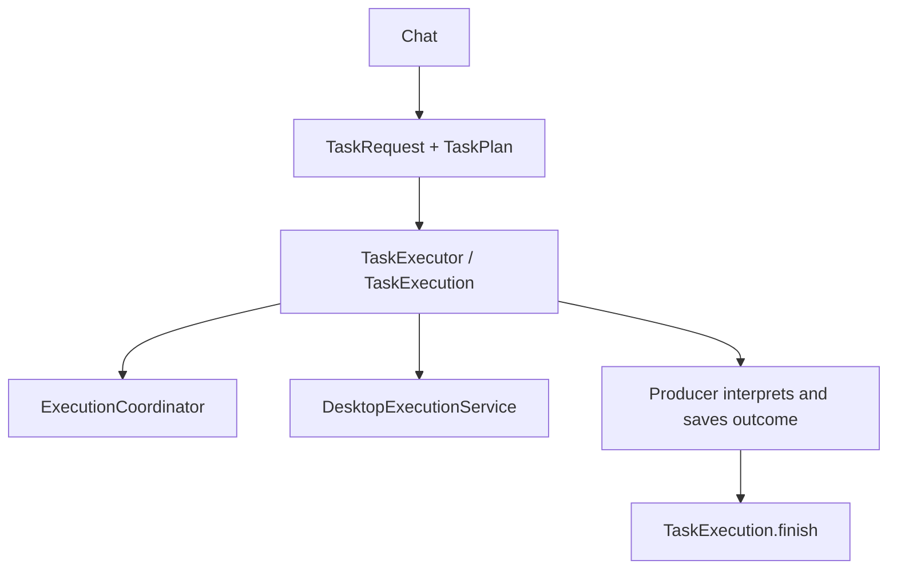

# Shared task execution

## Producers and execution

Chat is the producer of model work that may control the computer, and it goes through the app's one execution entry
point. The other model work in the app keeps its own rules and never reaches the desktop:

- `Assistant` supplies chat content and interprets replies. It passes its existing conversation coordinator so
  follow-up messages retain conversation history. A turn that may control the computer becomes a background task.
- `Minister` (Attend) runs its two turns, triage and compose, through its own client with the four reading tools and
  one answering tool each. It has no desktop tools and never runs anything; see [the minister](../plans/attention-minister.md).
- A job's `job.py` runs through `FolderJobRunner` and the script runner, with no model at all.

`TaskRequest` identifies one execution and its presentation: ID, title, initial status, and task-panel or conversation
placement. `TaskPlan` supplies input content, image preparation, and a lazy preparation closure returning
`PreparedExecution`. That closure selects the system instructions and tool capabilities appropriate to the producer;
the executor does not infer an action's authority.

## Ownership and completion

`TaskExecutor.begin` reserves an execution and returns a `TaskExecution` handle. The handle runs its plan once through
`ExecutionCoordinator`, connects cancellation and native cleanup to `DesktopExecutionService`, and owns task-panel
progress and completion. Native background work can promote a conversation onto the task panel without creating
another execution. Headless chat, which has no desktop service or task panel, continues to use the coordinator directly.

The producer interprets the returned `ExecutionResult` before calling `TaskExecution.finish`. Chat interprets the reply
for its conversation or promoted task surface; a model reply alone never counts as the task having done what was asked.

Native cleanup occurs as the coordinator completes; explicit `finish` records the producer's final outcome and releases
task presentation ownership. The executor does not own persistence or scheduling; those stay with each producer.

## Storage and views

The task panel displays execution progress and outcomes for up to 20 tasks, until Noteling quits. What jobs find lives
with the jobs (`job-results/`), the minister's matters in `matters/` and its log in `memory/`; the Jobs window presents
them. These surfaces are not separate execution engines.

Earlier versions' source ingestion, card generation and the Morning folder's work queue were producers here too; they
were removed in 0.8.1 with the Morning folder.
